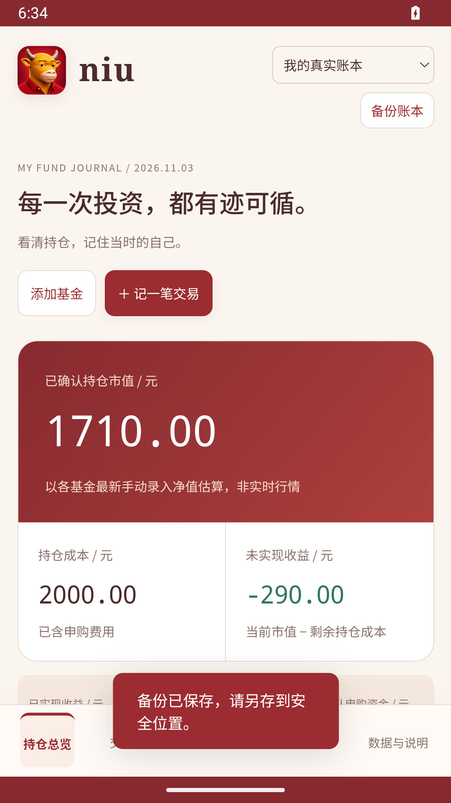

# niu · 基金日记

## 安卓下载

[下载最新 niu 安卓安装包](https://github.com/WeipingWu2023/niu/releases/latest)。Android 8.0+，需保持 Android System WebView 更新。应用名称 niu，包名 `cn.weiping.niu`。下载 APK 后在手机打开安装，更新请直接覆盖安装，保留本机账本。未上架应用商店。

应用离线运行，无联网、交易账户、联系人或广泛存储权限。WebView 加载打包到 APK 的网页，备份与恢复使用系统文件选择器。网页与 App 的账本独立：先从网页导出 JSON，再在 App 中恢复。卸载或清理 App 数据前务必备份。

安卓模拟器实测截图（含正常备份成功提示）：

## 安卓开发与发布

运行 `npm run android:prepare` 同步网页资源，再使用 JDK17、Gradle8.9、Android SDK35 执行 `gradle -p android assembleRelease`。GitHub Actions 负责编译与测试；签名留在本机，见 [发布签名说明](RELEASE_SIGNING.md)。技术依据：[本地 WebView 内容](https://developer.android.com/develop/ui/views/layout/webapps/load-local-content)、[AGP8.7兼容要求](https://developer.android.com/build/releases/agp-8-7-0-release-notes)、[系统文档选择器](https://developer.android.com/training/data-storage/shared/documents-files)。

图标与海报使用内置 imagegen 按用户截图创作，不代表电影官方出品或合作。MIT 适用于软件代码，不授予第三方角色权利。生成提示见 [美术资产说明](ASSETS.md)，海报手机画面已标明界面示意。

个人使用的中文基金账本，移动端优先，数据保存在浏览器本地。仅支持人民币计价的场外开放式非货币基金。不连接交易账户、不下单、不提供实时行情或投资建议。

## 启动

安装 Node.js 20 或更高版本。在本目录终端执行 `npm start`，打开 http://127.0.0.1:5173 。无需安装依赖、无需构建。测试用 `npm test`。停止服务用 Ctrl+C。

本地服务仅监听本机。电脑窗口缩小即可使用手机布局；第一版不提供手机跨设备同步或外网访问。不要在不可信的共享电脑录入真实数据。

## 第一只基金怎么录

1. 保持右上角“我的真实账本”。点“添加基金”，填写名称、六位代码、A/C 类别、交易账户和产品类型。同代码不同类别、不同账户分开建立。
2. 已有持仓可勾选期初，填写截止日、已确认份额、剩余持仓成本（含费用）。截止日当天及以前的交易已包含在期初里，不要再次录入。期初不是虚构交易，不推算缺失历史收益。
3. 点“记一笔交易”。提交时选“待确认”，记录金额、提交时间和唯一流水号，可同时写理由、预期、情绪和复盘日期。预计日期没有可靠规则时留空。
4. 收到回执后，在“等待回执”中修改，填实际成交净值日、净值、实际费用、确认份额、实际确认日，再选“已确认”。核对弹窗展示成本、份额、均价和占比前后变化。
5. 点“维护净值”，按官方公布值填写净值所属日、公布时间和值。手动录入时间自动保存。基金详情可查看三个时间和所有交易。

## 需求范围与数据模型

- 总览：确认市值、含费成本、未实现、已实现、累计/记录期间盈亏、资产占比、待确认申购资金、净值日期。待赎回交易单独列出，到账前不冲减份额、不计待申购资金。
- 基金：名称、代码、类别、账户、普通/QDII 类型、期初、事件暂停标志。每个基金持仓由“代码 + 类别 + 账户”唯一标识。
- 交易：稳定 ID、基金、唯一回执号、自定义流水、买卖类型、四种状态、提交时刻、预计/实际成交日期、实际成交净值、含费申购金额/费前赎回金额、费用、实际份额、预计/实际确认日期、日记字段。
- 净值：基金、所属日、公布时间、录入/抓取时间、来源。同一基金同一天再次录入是修正，保留前后值。
- 审计：每次更改保存原值、新值、时刻及原因，不删除历史记录。原交易数据保留在审计中。任何交易修改均从当前有效原始记录重新计算，非法历史（例如超额赎回）整笔拒绝。
- 重复保护：稳定 ID 保证反复保存幂等；同基金的回执号不能重复；恢复合并相同 ID 相同内容跳过，不同内容报冲突。记录 ID 与回执均不同的两条真实订单无法自动判断是否同一笔，请核对回执。CSV 只导出，不提供 CSV 导入。
- 模拟器：计划含费金额、假设净值、假设费用，计算份额、均价、成本、占比变化；结果不入账。

## 计算口径

核心位于 `core.js`，无第三方依赖。所有金额、份额、净值以十进制字符串持久化；计算采用 BigInt 定点整数，尺度 10^8，乘除保留8位小数，半入四舍五入（负数同样按绝对值半入）。输入最多12位整数、8位小数。BigInt 不受 JS 二进制浮点误差影响。中间过程8位精度，并非无限精度。

- 申购：金额是实际含费用支出，成本增加该金额；份额取回执实际确认份额，不靠金额倒推正式份额。核对 `份额 × 净值 ≈ 含费金额 − 申购费`，绝对差不得超过0.02元，容纳回执尾差；超过时须先核对。不支持预扣费用以外的复杂费用现金流。
- 赎回采用移动加权平均成本：结转成本 = 赎回前总成本 × 赎回份额 / 赎回前总份额，直接按整数比值舍入至8位，避免先舍入平均价；赎回费前总额与份额×净值容差0.02元。已实现收益增加 `费前金额 − 赎回费 − 结转成本`。全部赎回时结转全部剩余成本；清仓后新买入的均价重新开始，历史已实现收益继续保留。
- 剩余成本包含申购费用。不重复扣除净值已计提的管理费、托管费、销售服务费。
- 最新市值 = 已确认份额 × 最新手动录入净值。每只基金市值四舍五入到分后汇总；未实现收益 = 市值 − 剩余成本；累计盈亏 = 已实现 + 未实现。收益内部可有8位成本尾数，页面金额显示2位，各显示项相加有时有0.01元舍入差。
- 界面份额显示4位、均价4位、占比1位；完整输入保存在备份中。不同净值日期的基金组合不是同日估值，逐只列日期。有持仓缺净值时，总市值、组合未实现收益和占比不显示，不能把缺失值当零。
- 确认弹窗和时间线的成本、份额变化是该笔实际成交顺序的前后状态；占比使用当前其他持仓和最新录入净值作对比，不冒充历史组合占比。
- 模拟份额用 `(含费支出−费用)/假设净值`，该基金全部份额按假设净值估值，其他基金用各自最新手动净值。仅供试算。
- 期初导入标记历史不完整，“累计”改称“记录期间”，不创造过去的交易、现金流或累计收益。

## 日期

业务时区固定 Asia/Shanghai；日期是 `YYYY-MM-DD`，业务时刻是该时区墙上时间 `YYYY-MM-DDTHH:mm[:ss]`。备份根字段标明时区。不使用设备本地时区解释业务时刻。

不推算开放日，不将周一到周五直接作为基金开放日。不提供默认 T+1、T+2；QDII 独立标识，所有预计日期缺规则时显示“待核实”。已确认必须填实际回执数据。成交日不得早于提交日，确认日不得早于成交日或晚于今天。

重新计算按实际成交净值日、提交时间、ID 顺序排列同日交易。若同日相互依赖的订单回执存在特殊顺序，请按真实提交时间核对；第一版无独立成交顺序编辑器。

## 净值接口

第一版仅手动。账本统一读取 `latestNav(db, fundId)`，输入记录结构为 `{id,fundId,date,value,publishedAt,fetchedAt,source}`。未来数据提供方只需生产该结构并经 `saveRecord/validate` 写入；不得绕过日期校验或虚构公布时间。未实现任何真实行情接口。

## 备份与恢复

右上“备份账本”或“数据与说明 → 下载完整JSON备份”。文件包含完整基金、期初、净值、交易、日记、审计与版本、时区及账本类型。请另存到安全位置；本地保存不等于备份。备份包含个人账户名和操作记录，没有加密。

“从 JSON 恢复”先验证结构、关系、数值、日期、重复流水和历史可行性，再显示条数与重算成本市值，确认后一次性提交到 localStorage。恢复前会触发当前账本备份下载（请留意浏览器下载限制）。相同备份重复恢复不重复入账。有修改冲突不覆盖；要恢复旧快照，可用一个新的浏览器配置/空白网站存储恢复（务必先备份当前账本）。不提供一键清空真实账本。

真实账本和演示分别使用 `fund-diary-v1-real` 与 `fund-diary-v1-demo`，备份来源类型也校验，不能互相导入。导出CSV防表格公式注入并包含 UTF-8 BOM；类型/状态为稳定英文值 buy/sell、pending/confirmed/failed/cancelled。

保存失败（存储已满、浏览器阻止存储）不更新内存正式账本。读取失败保留原数据并提供原文下载。多标签页检测存储变化，保存前检查版本，避免静默覆盖；本地单次写入无后端事务或强并发锁。浏览器数据可被本机用户编辑，审计不是防篡改凭证。

## 未支持

分红、红利再投资、份额拆分、转换、转托管、多币种、货币基金、交易所基金、税务、自动开放日历、自动净值、现金账户核算、云同步、账户连接和自动下单均不支持。

发生不支持的事件时，在基金详情点击“登记分红/再投资/拆分事件”，暂停其收益展示，同时停止组合收益汇总。账面份额、成本与估值仍显示供核对，并明确标记可能失效；软件不会自动获知未登记事件。只有依据官方资料调整期初与后续账目并核对后，才可手动恢复计算。复杂历史应保持暂停，不能假装准确。

## 验证

`npm test` 覆盖指定无费用案例、含费申购、部分赎回、清仓后重新买入、状态隔离、重复保存/导入、历史更正审计和重算、超额赎回、坏日期、缺失净值、期初、事件阻断、不同类别/账户、模拟不入账、CSV转义与JSON往返恢复。界面验收见 `QA.md`。
